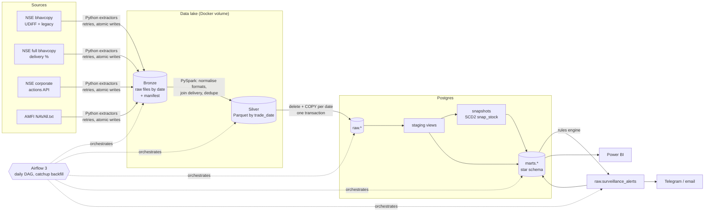

# Architecture

## Why each piece is there

| Decision | Reason |
|---|---|
| Bronze keeps raw files exactly as downloaded | NSE changes formats (it moved to UDiFF in July 2024). With raw files kept, history can be re-parsed without re-downloading. |
| Spark only for equities | It's the one source that grows with history and symbols. NAVs and corporate actions are small, so plain pandas is simpler. |
| Dynamic partition overwrite (Silver) and delete+COPY in one transaction (raw) | Every step is idempotent: re-running a date replaces it exactly, so backfills and retries are safe. |
| Split/bonus adjustment in dbt, fact as a full table | A new corporate action changes ALL earlier adjusted prices. An incremental model would leave them stale. |
| SCD Type 2 snapshot for stocks | Renames and sector changes keep history: each fact joins to the attributes valid on its date. |
| Surveillance in Python, modelled back in dbt | Rolling statistics and readable reasons are clearer in pandas. dbt keeps lineage and tests on the output. |
| `catchup=True`, `max_active_runs=1` | Turning the DAG on backfills every trading day in order, at a pace NSE tolerates. |
| Missing file today → retry; missing in the past → skip | NSE publishes around 6–7 pm, so today's file may not exist yet. A past gap is a holiday. |
| dbt in its own venv inside the Airflow image | dbt and Airflow pin conflicting libraries. |
| Alerts never sent during backfill | The `notify` task only sends for the latest day, and only when `ALERTS_SEND=true`. |

## Data quality layers

1. **Extract:** atomic writes, a manifest of every attempt with a sha256, and an HTML-error-page check on JSON.
2. **Silver:** invalid bars are dropped and counted; deterministic de-duplication.
3. **dbt tests (31):** keys, relationships, accepted values, OHLC consistency, no rows on holidays,
   adjusted series continuity (catches a missing split), holdings sanity.
4. **Post-load checks:** freshness, row count vs the 20-day median, null prices, marts reconciled
   to raw, no orphan facts.

Any failure stops the DAG before dashboards or alerts see the data.
